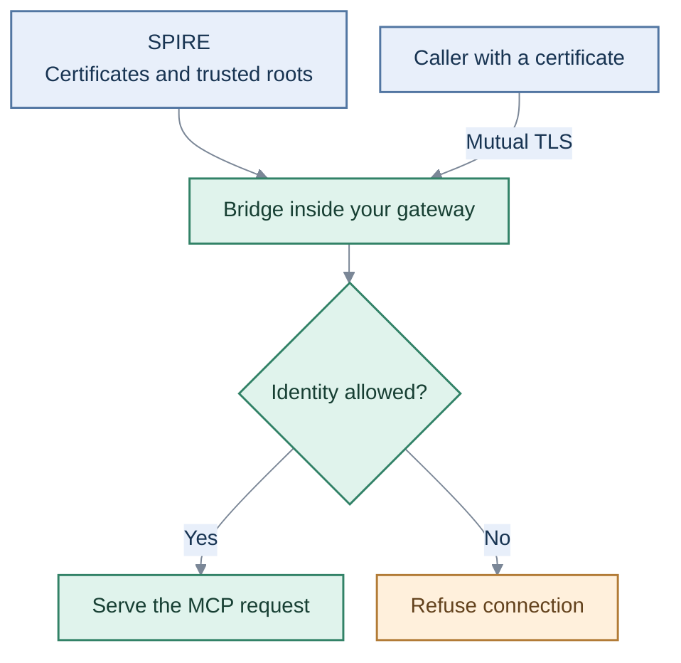

Workload identity / mTLS

# Check who connects before serving a tool.

Embed identity checks in an MCP gateway. Callers prove who they are with short-lived certificates; unapproved connections are refused.

## How it works

[Demo guide](kubernetes-lab.md){ .overview-link }
[Certificate lifecycle](credential-lifecycle.md){ .overview-link }
[Readiness and limits](publication-readiness.md){ .overview-link }

!!! note "Scope"
    Local review only; not published yet. Tool permissions remain a separate OAuth boundary.
